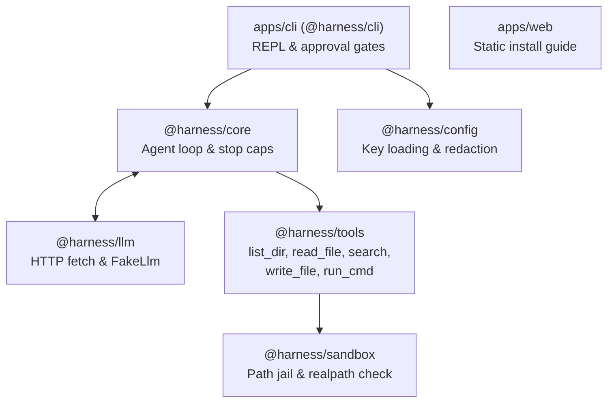

# Walkthrough - AI Coding Harness Monorepo

We bootstrapped, built, and verified the complete AI coding harness monorepo in TypeScript / Node.js 22 LTS according to [SYSTEM-DESIGN.md](./SYSTEM-DESIGN.md) and [apps/web/DESIGN.md](./apps/web/DESIGN.md).

## What was built



### 1. Monorepo Root & Workspace Setup
- Configured [pnpm-workspace.yaml](./pnpm-workspace.yaml) covering `packages/*` and `apps/*`.
- Configured base TypeScript project references in [tsconfig.base.json](./tsconfig.base.json) and [tsconfig.json](./tsconfig.json).
- Synchronized [AGENTS.md](./AGENTS.md) and [README.md](./README.md) to match the TypeScript/Node.js 22 stack while preserving all security invariants.
- Set up root [package.json](./package.json) with build, clean, and test scripts.

### 2. `@harness/sandbox`
- Implemented [`Sandbox`](./packages/sandbox/src/sandbox.ts):
  - 4-step canonical path verification using `path.resolve` and `fs.realpath`.
  - Directory escape checks rejecting `..` and absolute paths.
  - Case-sensitivity checks on case-insensitive filesystems.
  - Zero dependencies outside of Node.js built-ins.
- Comprehensive unit tests in [`sandbox.test.ts`](./packages/sandbox/test/sandbox.test.ts) covering relative paths, missing target ancestors, path traversals, and symlinks escaping the workspace.

### 3. `@harness/config`
- Implemented [`Secret`](./packages/config/src/secret.ts):
  - Wraps API keys, returning `"[redacted]"` for `toString()`, `toJSON()`, and `util.inspect()`.
  - Only exposes the raw key via `reveal()` for HTTP headers.
- Implemented [`loadConfig`](./packages/config/src/config.ts) and [`saveConfigFile`](./packages/config/src/config.ts):
  - Resolves environment variables (`HARNESS_API_KEY`) and user config files (`~/.config/harness/config.json`).
  - Enforces `0o600` file permissions on saved configuration.

### 4. `@harness/tools`
- Implemented [`ToolRegistry`](./packages/tools/src/registry.ts):
  - Automatic JSON Schema conversion from Zod schemas for LLM tool declarations.
  - Model argument validation with graceful error output back to the model upon failure.
- Implemented the 5 tools:
  - [`list_dir`](./packages/tools/src/tools/list_dir.ts): Sandboxed directory listing.
  - [`read_file`](./packages/tools/src/tools/read_file.ts): Line-numbered reading with offset, limit, and size capping.
  - [`search`](./packages/tools/src/tools/search.ts): Substring and regex workspace search ignoring build and cache directories.
  - [`write_file`](./packages/tools/src/tools/write_file.ts): Unified diff generation via `diff` library, approval prompt, and atomic file write.
  - [`run_cmd`](./packages/tools/src/tools/run_cmd.ts): Mandatory explicit approval prompt, timeout (60s), output capping, and process cancellation via `AbortSignal`.

### 5. `@harness/llm`
- Implemented [`FetchLlmClient`](./packages/llm/src/client.ts):
  - Native `fetch`-based OpenAI-compatible client.
  - Securely passes `Authorization: Bearer <key>` in headers only.
  - Zod validation on API responses.
- Implemented [`FakeLlm`](./packages/llm/src/fake_llm.ts) for deterministic, zero-network testing.

### 6. `@harness/core`
- Implemented [`runAgent`](./packages/core/src/agent.ts):
  - Agent loop tracking user goals, assistant responses, and tool outcomes.
  - Step counter and `maxSteps` (default 25) safeguard.
  - Token aggregation and `AbortSignal` propagation.

### 7. `apps/cli` (`@harness/cli`)
- Implemented [apps/cli/src/index.ts](./apps/cli/src/index.ts):
  - CLI options parser via `node:util` `parseArgs` (`--dir`, `--model`, `--max-steps`, `--yes-writes`, `--setup`, `--help`).
  - Interactive REPL prompt (`> `).
  - TTY-aware color formatting with `NO_COLOR` support.
  - Step logging: `[step N] tool_name args...`.
  - Ctrl-C abort handling returning to the prompt without crashing.
  - First-time setup wizard (`harness --setup`).

### 8. `apps/web` (Static Install Guide)
- Implemented [index.html](./apps/web/index.html), [style.css](./apps/web/style.css), and [copy.js](./apps/web/copy.js) matching [apps/web/DESIGN.md](./apps/web/DESIGN.md).
- Total weight: **16.2 KB** (budget: < 50 KB), zero external dependencies, no framework, works without JS.

---

## Verification Results

### 1. Package Isolation Rule Check
- `tools` never imports `core` or `llm` (verified).
- `llm` never imports `tools` (verified).
- `sandbox` depends strictly on Node.js built-ins with zero npm packages (verified).
- Only `core` wires `llm` and `tools` together (verified).

### 2. Automated Test Suite (`pnpm test`)
```
✓ packages/sandbox/test/sandbox.test.ts (6 tests)
  - resolves valid paths inside workspace
  - resolves non-existent file paths destined for creation
  - rejects path traversal attempts with ..
  - rejects absolute paths outside workspace
  - rejects symlinks that point outside workspace
  - allows symlinks that point inside workspace

✓ packages/config/test/config.test.ts (4 tests)
  - never prints secret key in toString, toJSON, or util.inspect
  - throws clear error when API key is missing
  - loads API key and options from environment variables
  - loads configuration from file and persists with saveConfigFile

✓ packages/llm/test/client.test.ts (3 tests)
  - sends proper headers and parses OpenAI-compatible response
  - handles provider HTTP error cleanly
  - FakeLlm delivers scripted responses in order

✓ packages/tools/test/tools.test.ts (7 tests)
  - converts tool schemas to valid OpenAI-compatible function definitions
  - handles unknown tool and invalid arguments safely
  - list_dir lists entries accurately
  - read_file returns line-numbered content and slices
  - search locates strings across files
  - write_file prompts for approval and renders unified diff
  - run_cmd asks for confirmation and runs in workspace

✓ packages/core/test/agent.test.ts (4 tests)
  - completes immediately when model has no tool calls
  - executes multi-step tool calls and reports steps
  - enforces maxSteps limit when model calls tools indefinitely
  - respects AbortSignal and aborts promptly

✓ packages/core/test/cli_e2e.test.ts (1 test)
  - runs full agent loop through the CLI binary against a local mock server

Test Files: 6 passed (6)
Tests:      25 passed (25)
Duration:   1.55s
```

### 3. Build & CLI Smoke Testing
1. **Compilation**: `pnpm clean && pnpm build` passed cleanly with strict TypeScript project references across all packages.
2. **Help flag**: `node apps/cli/dist/index.js --help` correctly displays usage and options.
3. **Missing key check**: `node apps/cli/dist/index.js` outputs `API key not set. Export HARNESS_API_KEY or run harness --setup.` with zero traceback.
4. **End-to-End Execution**: Spawned CLI against a live mock server; successfully executed `list_dir`, `write_file`, and created files on disk in the sandboxed directory.
5. **Bundle size check**: `wc -c apps/web/*` verified total static site assets are ~16.2 KB (< 50 KB budget).
